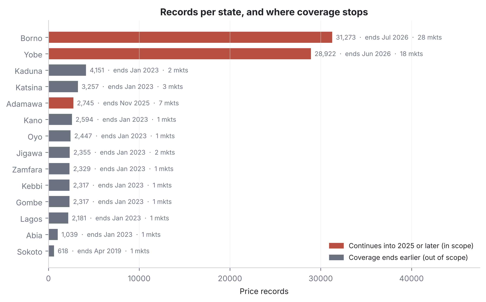
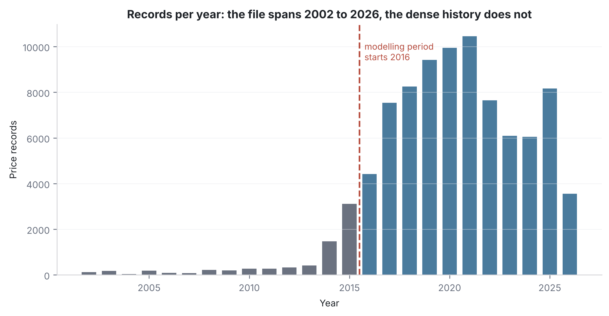
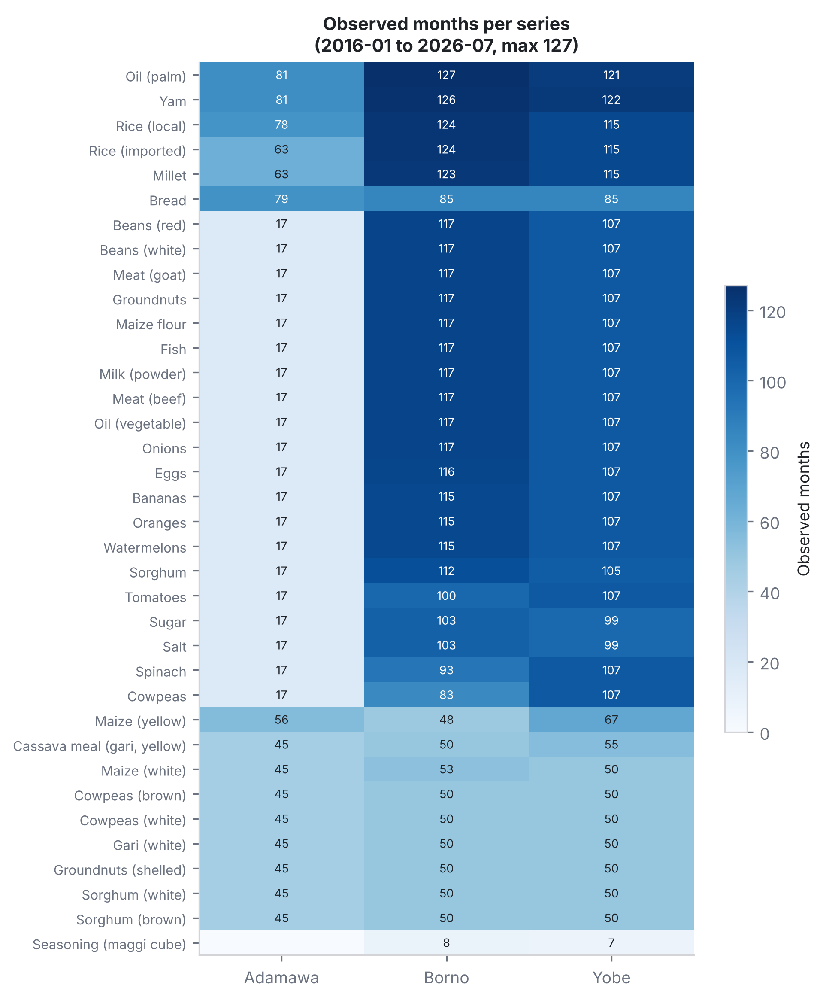
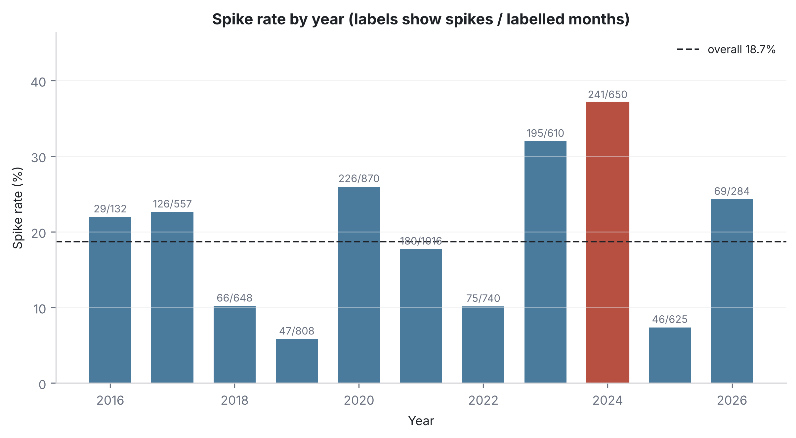
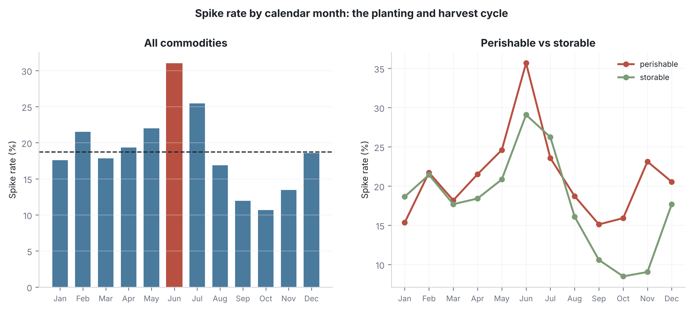
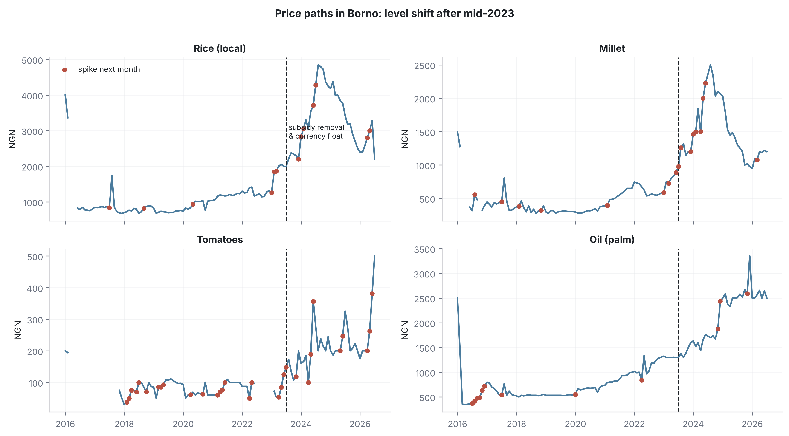
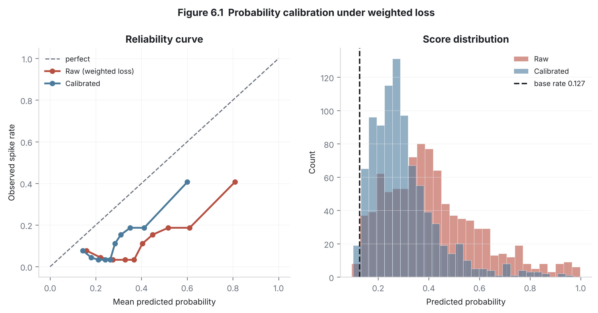

# A Monthly Early Warning System for Food Price Spikes in Nigerian States

**04-652 Artificial Intelligence System Design, Fall 2026**
Nimat Ohunene Sadiq · Carnegie Mellon University Africa · `nsadiq@andrew.cmu.edu`

---

## Problem Statement

Nigerian state governments and relief agencies learn that staple food prices
have spiked only **after** it has happened. Support therefore reaches
households after they have already reduced consumption or sold assets, and
food is procured at peak prices.

Food inflation runs well above general inflation and varies sharply by state.
In July 2026 food inflation was 20.31% against a headline rate of 15.43%, and
in April 2026 Enugu recorded 32.67% against a national figure of 16.06%. Prices
are measured well in Nigeria, but every published source is retrospective.
Nothing forecasts the coming month at state level.

This project predicts, one month ahead, whether the price of a given staple in
a given state is about to rise sharply above its recent trend. The output is a
monthly ranked warning list, giving enough notice to release grain reserves,
begin cash transfers, or procure relief food before prices rise.

**SDG 2 (Zero Hunger)**, Target 2.1 (access to sufficient food year round) and
Target 2.c (timely market information to limit extreme food price volatility).

## Task Type

**Binary classification.** For each `(state, commodity, month)`, predict whether
the price in month *t+1* exceeds its trailing three-month mean by more than 15%.

---

## Dataset Overview

**Source:** WFP Food Prices for Nigeria (WFP Vulnerability Analysis and Mapping
Price Database, via the Humanitarian Data Exchange)
**Link:** https://data.humdata.org/dataset/wfp-food-prices-for-nigeria
**Retrieved:** 3 October 2026 · **Licence:** as stated on the HDX dataset page

The raw file is **not** in version control (see `.gitignore`). The notebook
downloads it automatically if `data/raw/` is empty.

> **This dataset is revised in place.** Three copies taken during this project
> held 88,556 records (21 Sep 2026), 88,545 (3 Oct 2026) and 88,391 (20 Oct
> 2026). All differences were removals; no price changed on any shared record.
> Results below use the **3 October** copy, and re-downloading will shift the
> numbers slightly. This is why the retrieval date is recorded as part of the
> audit rather than as a footnote.

### Two matrices

The file as distributed is not the matrix the model trains on.

| | Rows (N) | Columns (P) |
|---|---|---|
| Raw file, long format | 88,545 | 16 |
| Modelling panel (`state` × `commodity` × `month`) | 9,000 | 32 |
| Labelled rows (three prior months required) | 6,940 | 32 |
| Design matrix after encoding | 4,956 / 1,075 / 909 | **17** |

### What a few rows look like

| date       | admin1 | market          | commodity | unit   | pricetype | priceflag | price  | usdprice |
|:-----------|:-------|:----------------|:----------|:-------|:----------|:----------|-------:|---------:|
| 2026-06-15 | Borno  | Monday          | Millet    | 2.6 KG | Retail    | aggregate | 1262.5 | 0.93 |
| 2026-06-15 | Borno  | Tashan Bama     | Millet    | 2.6 KG | Retail    | aggregate | 1237.5 | 0.91 |
| 2026-06-15 | Borno  | Damassack (CBM) | Millet    | 2.6 KG | Retail    | aggregate | 1200.0 | 0.88 |
| 2026-07-15 | Borno  | Rann            | Millet    | 2.6 KG | Retail    | aggregate | 1200.0 | 0.87 |

One row is **one market, one commodity, one month**. Dates are always the 15th,
so the column encodes a month rather than a day. Several markets in the same
state report the same commodity in the same month, which is why the panel
collapses them to the state **median** (robust to a single besieged market
printing several times the state norm).

### Variable inventory

| Column | Type | Distinct | Note |
|---|---|---|---|
| `date` | Datetime | 295 | Always the 15th; a month index |
| `admin1` | Nominal | 14 | State |
| `admin2` | Nominal | 49 | LGA; unused at state level |
| `market`, `market_id` | Nominal | 68 | Aggregated away |
| `latitude`, `longitude` | Continuous | 56 / 59 | Market location |
| `category` | Nominal | 8 | Food group; source of `food_type` |
| `commodity`, `commodity_id` | Nominal | 43 | |
| `unit` | Nominal | 20 | Consistent *within* a commodity |
| `priceflag` | Nominal | 3 | `actual` / `aggregate` |
| `pricetype` | Nominal | 2 | Retail (76%) / Wholesale |
| `currency` | Nominal | 1 | Constant NGN; zero variance, dropped |
| `price` | Continuous | 25,876 | **The signal** |
| `usdprice` | Continuous | 8,914 | Derived; never used (moves with the currency) |

### Data quality

| Check | Result |
|---|---|
| Missing cells in the raw file | **0** |
| Fully duplicated rows | 0 |
| Duplicates on `(date, market, commodity, unit, pricetype)` | 0 |
| Gap months once reshaped to a monthly grid | 1,132 of 9,000 (12.6%) |
| Single-month gaps interpolated and flagged | 356 |

**The raw file has no nulls, and that is a trap.** WFP publishes only observed
records, so a market that fails to report produces *no row at all*. Missingness
is structural and becomes visible only after reshaping onto a continuous
monthly grid. The duplicate check on the natural key matters more than the
identical-row check: it asks whether one market reported the same commodity
twice in a month at different prices, which would force a choice about which to
keep. It does not happen here.

### Target variable (Y)

`spike_next_month` ∈ {0, 1} — price in *t+1* above its trailing three-month
mean by more than 15%.

| | Value |
|---|---|
| Labelled rows | 6,940 |
| Positive | 1,300 (18.7%) |
| Negative | 5,640 (81.3%) |
| Imbalance | **4.3 : 1** |

Handled with class weighting (`class_weight='balanced'`, `scale_pos_weight`),
not synthetic oversampling: SMOTE interpolates between neighbouring months and
would fabricate price histories that never occurred.

---

## What the data looks like, and what we decided

Each chart below is followed by the decision it led to. The decisions are the
point; the charts are the evidence.

---

### 1. Most states stop reporting in 2023



**What this shows.** WFP collects prices only where it runs operations. Borno
and Yobe have the most records and are the only states still reporting into
2026. Adamawa stops in November 2025. **Eleven of the fourteen states stop in
January 2023**, and most of southern Nigeria never appears at all.

**Decision 1: use only Borno, Yobe and Adamawa.**

The other eleven states have no data after January 2023. We are predicting next
month's prices, so a state that stopped reporting three years ago cannot be
predicted for and cannot be tested on. Keeping them would add rows to the
training set that teach the model about a period we no longer care about, while
giving nothing to test against.

**Decision 2: keep Adamawa, even though its bar looks tiny.**

The bar chart makes Adamawa look like 3% of the data. That is misleading, and
here is why.

The bar counts **rows**, and one row is one market. Borno has 28 markets, Yobe
18, Adamawa only 7. But our model does not predict for individual markets. It
predicts for a **whole state**, so we combine all the markets in a state into
one number per food per month.

Once we do that, Borno's 28 markets become one value, exactly like Adamawa's 7.
The gap closes dramatically:

| State | Share of raw rows | Share of modelling rows | Foods tracked |
|---|---|---|---|
| Borno | 49.8% | 44.8% | 36 |
| Yobe | 47.2% | 43.1% | 36 |
| Adamawa | **2.9%** | **12.1%** | 35 |

Adamawa goes from 3% to 12%. It was never short of information. It was short of
**markets**, which is a different thing. It tracks almost the same list of foods
as the other two.

**Is the model unfair to the smaller state?** We checked, and no. On the test
data the model catches 83.3% of spikes in Borno and 83.0% in Yobe. Nearly
identical, so having more rows from Borno does not make the model better at
Borno.

**What we will say honestly.** Adamawa's real problem is not size, it is timing.
Because its data stops in November 2025, it contributes only 25 rows to the test
period, containing 2 spikes. You cannot measure anything reliably from 2 events.
So we keep Adamawa for training, where it adds a third region outside the
Borno-Yobe conflict area, and we report its test scores separately with a note
that they are not meaningful.

---

### 2. The early years are almost empty



**What this shows.** The file says it covers 2002 to 2026. But look at the bars
before 2014: they are almost invisible. The real data starts around 2014 and
becomes dense from 2016.

**Decision 3: start the modelling period at January 2016.**

Three reasons, in order of how much they matter.

First, **those old rows cannot produce anything usable anyway.** Our model looks
backwards: to make a prediction for a given month it needs the previous 12
months of that food in that state. A handful of scattered records from 2008 has
no 12-month history behind it, so no row can be built from it. Those records
were never going to enter the model.

Second, **it was a different economy.** Before 2016 the naira was pegged and
fuel was subsidised. Prices behaved by different rules. Teaching the model those
rules would teach it something that is no longer true.

Third, it is cheap. Cutting everything before 2016 removes only **7.9% of the
file**.

**Does this change the first chart?** Barely, which is worth knowing. After the
2016 cut, Borno and Yobe go from 68% to 72% of records. The ranking of states
does not change. So the two decisions are independent: we are not cutting years
in order to fix the state balance, and cutting years does not undo the state
decision.

---

### 3. How long each food has been tracked



**What this shows.** Each square is one food in one state. The number inside is
**how many months that food was recorded**, out of a possible 127. Darker means
more months. This is not how many prices were collected in a single month; it is
how long the record runs.

**Decision 4: set a minimum length before a food can enter the model.**

A food recorded for only 20 of 127 months cannot support a 12-month lookback.
It would contribute almost no usable rows while still adding another category
for the model to learn. Short series are better left out than half-used.

This is a **data decision that creates a model decision**: once we fix the
minimum length, the list of foods changes, which changes the feature set.

---

### 4. Some years are far worse than others



| Year | Spike rate | Year | Spike rate |
|---|---|---|---|
| 2016 | 22.0% | 2022 | 10.1% |
| 2017 | 22.6% | 2023 | 32.0% |
| 2018 | 10.2% | **2024** | **37.1%** |
| 2019 | 5.8% | 2025 | 7.4% |
| 2020 | 26.0% | 2026 | 24.3% |
| 2021 | 17.7% | | |

**What this shows.** 2024 was the worst year, with 37% of months spiking. 2019
was the calmest at under 6%. That is a six-fold difference between years.

**What happened in 2024, and can a model learn it?**

First we checked whether it was one bad crop or something general. In 2024
**every single food** spiked, in all three states, at between 36% and 42%. A
crop failure hits some foods. This hit everything.

The cause is visible in your own file. If you divide the naira price by the
dollar price, you recover the exchange rate WFP used:

| Year | Naira per US dollar |
|---|---|
| 2022 | 415 |
| 2023 | 759 |
| 2024 | **1,575** |

The naira lost almost three quarters of its value in two years. This followed
the removal of the fuel subsidy and the floating of the currency in mid-2023.

**So this is not a statistical pattern. It is a government policy decision.**
Nothing in the history of food prices could have predicted it, because the cause
was not in food prices. It was in a policy announcement.

**Decision 5: three things, none of which pretend the model can predict policy.**

1. **Add the exchange rate as an input.** We cannot predict the devaluation, but
   once it is happening, the model can see it instead of being confused by it.
2. **Add a marker for "after July 2023".** This lets the model treat the two
   periods as different worlds rather than averaging them into one.
3. **Retrain on a moving window.** Instead of training once on all history, keep
   retraining on recent months so the model follows the current regime.

This same event explains something in our results: our validation period has a
34.9% spike rate while training has 16.3% and testing has 12.7%. That is not a
mistake in the split. It is 2024 showing up.

---

### 5. June is the hungry month



**What this shows.** Spikes peak in **June (31%)** and bottom out in **October
(10.7%)**. Three times as likely in June as in October.

**Why June?** June is the end of the **lean season**. Last year's harvest has
been eaten or sold, the new harvest is still months away, and it is the middle
of the rainy season, so roads are bad and moving food costs more. By October the
harvest has arrived and prices settle.

We checked it is not one strange food: 35 of 36 foods spiked in June, in all
three states.

**But here is the catch, and it is important.** June is not reliably bad. Look
at June on its own, year by year:

| Year | June spike rate |
|---|---|
| 2019 | 5.8% |
| **2022** | **2.2%** |
| 2023 | 50.0% |
| **2024** | **64.0%** |

June beat its own year's average in 8 of 11 years, so the pattern is real. But
2.2% in one June and 64% in another means **knowing it is June tells you very
little by itself.**

This is exactly why our simple comparison rule fails. A rule that says "warn
every June, because June is usually bad" catches only 4.3% of real spikes. It
sounds sensible and does almost nothing.

**Decision 6: keep the month as an input, but make it work together with the
other inputs.**

We already encode the month in a way that knows December and January are next to
each other, not eleven months apart. The next step is to let the model combine
June **with** fuel costs, the exchange rate and recent price movement, so it can
tell a calm June from a dangerous one. June alone is a weak clue. June during a
currency collapse is a strong one.

The chart also shows perishables and storables separating after harvest:
storables drop to 8% by October while perishables stay near 16%. That is
independent evidence that splitting foods into those two groups is worth doing,
which supports a choice we had already made.

---

### 6. The prices themselves



**What this shows.** Four staple foods in Borno. The blue line is the price. Red
dots mark months where a spike followed. The dashed line is July 2023.

**Why include this chart at all?** Every other chart shows a summary. This one
shows the actual thing we are predicting, and it does four jobs at once.

1. **It proves our definition of "spike" is sensible.** The red dots sit on real
   climbs, not on random wobbles. Anyone can look and judge whether our 15% rule
   is picking out the right months.
2. **It makes the 2023 break visible.** Local rice roughly triples after the
   dashed line. You can see in one glance why a model trained on 2016 to 2022
   would struggle with 2024.
3. **It shows the foods behave differently.** Tomatoes jump around wildly at low
   prices; palm oil climbs smoothly. That is the perishable versus storable
   difference, visible in raw data rather than just claimed.
4. **It shows the gaps.** Where the line breaks, that month has no data.

**Decision 7: no new decision, but this is the chart that justifies several
others.** It is the only figure a non-technical reader can understand without
help, which is why it is worth keeping.

---

## Summary of decisions

| # | Decision | Driven by |
|---|---|---|
| 1 | Use only Borno, Yobe and Adamawa | Chart 1: eleven states stop in Jan 2023 |
| 2 | Keep Adamawa despite its small bar | Chart 1: row count measures markets, not information |
| 3 | Start the modelling period at January 2016 | Chart 2: earlier rows cannot form features |
| 4 | Require a minimum series length | Chart 3: short series cannot support a 12-month lookback |
| 5 | Add exchange rate, regime marker, rolling retraining | Chart 4: 2024 was a policy shock, not a price pattern |
| 6 | Keep month as an input, combined with other features | Chart 5: June is a real but weak signal on its own |
| 7 | Report Adamawa's test scores separately | Chart 1: only 25 test rows and 2 spikes |

---

## Repository Structure

```
.
├── README.md
├── .gitignore                       <- excludes data/
├── requirements.txt
├── data/
│   ├── raw/                         <- WFP file lands here (untracked)
│   └── processed/                   <- panel + results (untracked)
├── phase1_strategy/
│   └── Phase1_Strategy_Report.pdf   <- audit, imputation, leakage plan
├── phase2_implementation/
│   ├── notebooks/
│   │   └── pipeline_execution.ipynb <- runs end to end
│   ├── Phase2_Final_Report.pdf      <- decision log, strategy vs reality
│   └── Feedback_Response.pdf        <- response to Phase 1 review
├── src/
│   ├── transformers.py              <- custom scikit-learn transformers
│   ├── pipeline_builder.py          <- ColumnTransformer + Pipelines
│   ├── calibration.py               <- post-hoc probability calibration
│   ├── figures.py                   <- the 8 required diagnostics
│   └── eda_figures.py               <- the descriptive figures above
└── figures/                         <- all figures, 300 DPI
```

## Reproduction

```bash
git clone https://github.com/nimatsadiq/AISD_proj_F26.git
cd AISD_proj_F26
pip install -r requirements.txt
jupyter notebook phase2_implementation/notebooks/pipeline_execution.ipynb
```

On Colab, uncomment the clone and install lines in the first cell. The data
cell fetches the raw file from HDX if `data/raw/` is empty, so no manual
download is needed. No GPU is required: the data is tabular and fits in memory.

## Pipeline Summary

1. **Panel construction** — filter to retail prices in the three in-scope
   states; collapse markets to the state median; reindex each series onto a
   continuous monthly grid so gaps become explicit.
2. **Features** — backward-looking momentum, deviation from rolling means,
   volatility, cyclical calendar month, same month in prior years,
   neighbouring-state changes, fuel-price momentum, missingness flags.
3. **Label** — month *t+1* against the trailing three-month mean at 15%.
4. **Split** — forward chronological 70/15/15; no stratification, because it
   would require reshuffling and destroy temporal order.
5. **Models** — regularised logistic regression (scaled) and gradient boosted
   trees (unscaled), against a seasonal persistence baseline.

## Reports

| Document | What it covers |
|---|---|
| [Phase 1 Strategy Report](phase1_strategy/Phase1_Strategy_Report.pdf) | Data audit, missingness mechanisms, imputation and outlier rules, encoding and scaling, split design and leakage architecture |
| [Phase 2 Final Report](phase2_implementation/Phase2_Final_Report.pdf) | Decision log, five documented deviations, leakage verification |
| [Feedback Response](phase2_implementation/Feedback_Response.pdf) | Response to Phase 1 review, including probability calibration |

## Results

| Model | Threshold | Recall | Precision | PR-AUC | ROC-AUC | Precision@50 |
|---|---|---|---|---|---|---|
| Logistic regression | 0.37 | **0.835** | 0.194 | 0.353 | 0.737 | 0.480 |
| Gradient boosted trees | 0.39 | 0.504 | 0.195 | 0.301 | 0.635 | 0.500 |
| Seasonal persistence baseline | n/a | 0.043 | 0.714 | n/a | n/a | n/a |

Test base rate 0.127. Thresholds chosen on the validation split; test scored
once. Recall target of 0.80 met; the 0.60 precision target is not jointly
achievable at this base rate, so precision@50 is the honest operational figure.

Scores are **calibrated** post hoc (Platt scaling, fitted on validation only)
before any threshold is chosen, because weighted loss inflates raw
probabilities. Brier improves from 0.189 to 0.129 for the logistic model, while
precision@50 and PR-AUC are unchanged, since calibration is monotonic.



Full discussion in `Phase2_Final_Report.pdf` and `Feedback_Response.pdf`.

## Status

Phase 1 (strategy) and Phase 2 (implementation and diagnostics) complete.
